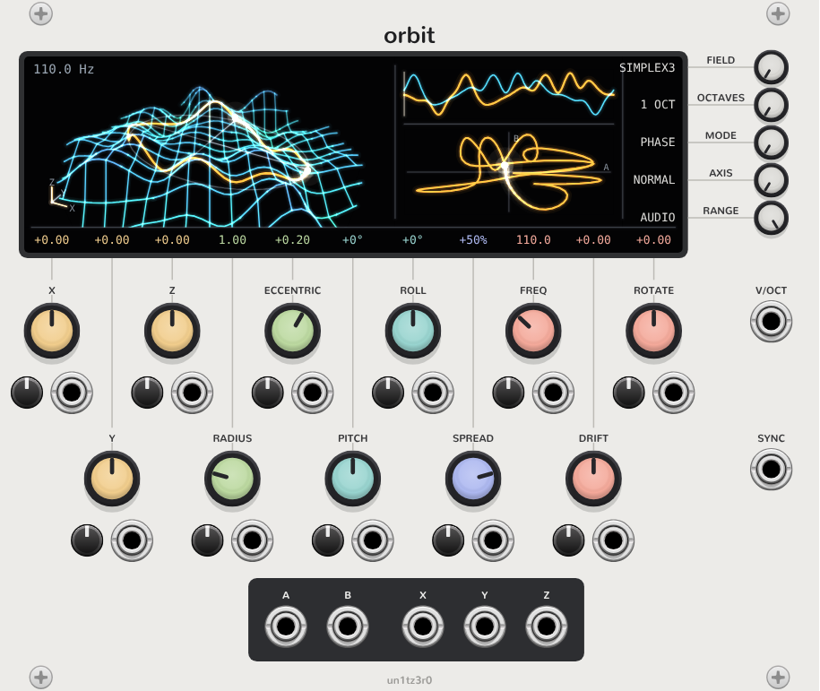
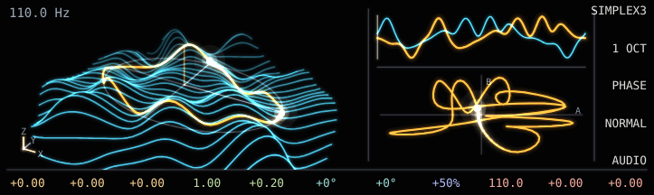

# Complex Oscillators for VCV Rack 2

Oscillators that read their waveforms off 3D fields by sweeping rings through them, each with an OLED-style 3D view of what it is doing.

## Orbit



Orbit sweeps an elliptical ring through a 3D field (OpenSimplex2 in 3D or 2D, a gyroid, or cellular noise, with up to 4 fractal octaves) and outputs what the ring reads.

- **Ring controls.** Center X/Y/Z, RADIUS, ECCENTRIC, PITCH and ROLL each have a knob, an attenuverter and a CV input. A full ±5 V CV sweep covers the knob's whole range. The radii are RADIUS·(1 ± eccentricity), so the ring stretches into an ellipse one way for positive values and the other way for negative ones, and collapses to a line at ±1. PITCH turns the ring about world X and ROLL then turns it about world Y. No two knobs do the same thing (see `DESIGN.md`).
- **Drift and rotation.** DRIFT moves the ring through the field along Z over time, and ROTATE turns it at up to one revolution per second about the AXIS selector's choice: the ring's normal (a spin within its plane), its major or minor axis (a tumble), or world X, Y or Z through its center. Both keep the timbre evolving.
- **Outputs A and B.** A reads the ring as the knobs set it. B reads it moved by SPREAD, from −100% to +100%, in MODE's way:
  - **Phase**: the same ring, `spread/2` of a cycle ahead.
  - **Pinch**: a copy scaled by up to 2× (or ½× for negative SPREAD) about the ring's phase-0 point, so the two touch there and fan apart on the opposite side.
  - **Stack**: a copy shifted along the ring's normal by up to one radius.
  - **Radial**: a concentric copy scaled by up to 2× or ½×.
  - **Fan**: a copy turned up to 90° about the diameter through phase 0, so the two cross at both its ends.

  Outside phase mode, B is read in step with A, so both pass phase 0 together, and SYNC resets them there.
- **X/Y/Z outputs.** The coordinates of A's sample point. Drift is left out so the voltages stay in range.
- **Range and polyphony.** RANGE switches between LFO and audio. The module is polyphonic across V/OCT and every CV input. SYNC is a hard reset of the phase.
- **Panel.** The eleven knobs sit in two rows, the second offset by half a step, each with its attenuverter and CV input beneath it. A wire runs from every knob up to the bottom of the screen, which shows that knob's value, CV included, where the wire arrives. The five selectors sit beside the screen and are wired to its right edge the same way. Panels follow Rack's dark-panel setting.
- **Anti-aliasing.** Orbit's waveform has as much detail as the ring passes through, so fast or large rings, and higher octaves, would fold harmonics back past Nyquist. By default, octaves above the first fade out before their detail reaches Nyquist, and each output reads the first octave 1, 2 or 4 times a sample, as few as the ring's speed allows, before filtering back down. Folded-back content measures about 90 dB down from 110 Hz to 1.76 kHz on rings of radius 1 to 2, and 68 dB down at 1.76 kHz on a radius-3 ring, against as little as 4 dB down with it off. The context menu can turn the oversampling or both off.
- **Context menu.** DC removal and level normalization are both on by default. They come from a survey of each ring taken every 512 samples. The menu also has the anti-aliasing setting, a new noise seed and the display options: its color (cyan, green, amber, violet or white), the side panel (waveforms, XY scope, both or off), equal XY scaling, and the floor's style (rows, grid or dots), density, brightness and hue shift with height.
- **Display.** The display shows the field slice as a relief floor, drawn as a grid of square cells by default and tinted slightly by height, with the rings lifted onto it (one cycle of each waveform wrapped around its ring), and each output's probe with its stem height as its current value. Arrows on the world axes in the corner show how fast the ring's center is moving along each, from CV or DRIFT. The side panel shows one cycle of A and B unrolled, and an XY scope of A against B with each axis fitted to its box. Both are computed from the field, so they stay sharp at any pitch. Drag the 3D view to orbit the camera. Audio-rate phase can't be drawn at frame rate, so above 2 Hz the probes turn at the pitch folded down by octaves to under 0.5 Hz.



## Layout

- `src/core/`: header-only and independent of Rack. OpenSimplex2 noise, fields, rings, the phasor, `OrbitShape` and `OrbitVoice` (the oscillator itself), a pinhole camera, the `Painter` drawing interface, `OrbitView` (a field's relief with rings lifted onto it) and `OrbitScene` (the whole display). `Panel` describes a front panel in millimetres and draws the plugin's knobs; `OrbitPanel` holds Orbit's ids, knob table and layout.
- `src/OledDisplay.*`: a Rack widget that paints a `Painter` scene with NanoVG on the light layer, so it glows when the room is dimmed.
- `src/PanelArt.*`: builds a module's widgets and paints its panel art from a `Panel`, following Rack's dark-panel setting.
- `src/Orbit.cpp`: the Orbit module and its display.
- `tools/render`: a headless renderer that uses the same core, view and panel code, so sounds and visuals can be checked without Rack.

## Building

```sh
make RACK_DIR=/path/to/Rack-SDK   # the plugin
make -C tools                     # the renderer
```

## Renderer

```sh
tools/render --out demo --orient 35,20 --radius 1.1 --eccentricity 0.3 --detail 1 --mode fan --spread 0.6 --rotate 0.25 --axis major
```

This writes `demo.wav` (32-bit float, A and B as two channels, about ±1), `demo-scope.svg` (two cycles) and `demo-view.svg`, which is the module's display drawn by the same code. With `--frames N` it writes `demo-view-0000.svg` and onward for animation. With `--panel light` or `--panel dark` it also writes `demo-panel.svg`, a mockup of the whole panel with its knobs set to the options. Pass `--rack` a Rack source or SDK folder to draw its jacks, trimpots and screws from its own artwork.

| Option | Default | Meaning |
|---|---|---|
| `--freq` `--seconds` `--rate` | 110, 2, 48000 | Audio pitch, length and sample rate |
| `--field` | simplex3 | `simplex2`, `simplex3`, `gyroid` or `cellular` |
| `--seed` | 0 | Noise seed |
| `--fractal` `--detail` `--roughness` `--lacunarity` | fbm, 0, 0.5, 2 | Fractal type (`fbm`, `ridged`, `hetero` or `hybrid`), octaves above the first (0 to 7, fractions fade the top one in), each octave's amplitude and frequency relative to the one below |
| `--cells` `--metric` `--lattice` `--jitter` `--smoothness` | smooth, euclidean, cubic, 1, 0.25 | Cellular feature (`f1`, `f2`, `edge`, `smooth` or `value`), distance metric (`euclidean`, `manhattan` or `chebyshev`), lattice (`cubic` or `bcc`), jitter 0 to 1, and smoothness up to 0.3 |
| `--warp` `--tilt` `--warp-scale` `--warp-drift` | 0, 0, 1, 0 | The second noise: how far it displaces space, how much it varies the roughness, its frequency, and its drift in units per second |
| `--distort` `--distortion` | none, 0 | Domain distortion (`twist`, `swirl`, `fold` or `ripple`) and its amount, 0 to 1 |
| `--shaper` `--drive` | off, 1 | Value shaper (`fold`, `sine`, `clip` or `rectify`) and its drive |
| `--center x,y,z` | 0,0,0 | Ring center |
| `--radius` `--eccentricity` | 1, 0.2 | Mean radius and eccentricity, −1 to 1 |
| `--orient pitch,roll` | 0,0 | Ring orientation in degrees |
| `--drift` | 0 | Center travel along Z, in units per second |
| `--rotate` `--axis` | 0, normal | Rotation in turns per second, about `normal`, `major`, `minor`, `x`, `y` or `z` |
| `--mode` | phase | Spread mode: `phase`, `pinch`, `stack`, `radial` or `fan`, as on the module |
| `--spread` | 0.5 | B's spread, −1 to 1, as on the module |
| `--remove-dc` `--normalize` | 1, 1 | Center and normalize each output as the module does |
| `--antialias` | 2 | 0 off, 1 octave fade, 2 octave fade and auto oversampling |
| `--frames` `--fps` `--size w,h` | 1, 30, 723,216 | View frames to write, and their size (default is twice the module display) |
| `--cam az,el` `--cam-orbit` | -60,29, 0 | Camera angles in degrees relative to the ring's plane, and orbit speed in degrees per second |
| `--view-rate` | 0.25 | Probe speed in the view frames, in cycles per second |
| `--accent` | 0 | Display color: 0 cyan, 1 green, 2 amber, 3 violet, 4 white |
| `--side` `--equal-xy` | both, 0 | Side panel (`off`, `waves`, `xy` or `both`) and equal XY scaling |
| `--floor` `--density` `--brightness` `--hue` | grid, 1, 2, 1 | Floor style (`rows`, `grid` or `dots`), and indices into the menu's density, brightness and hue shift choices |
| `--panel` `--rack` `--panel-scale` | none, none, 6 | Panel mockup (`light` or `dark`), Rack folder for component art, and pixels per millimetre |
